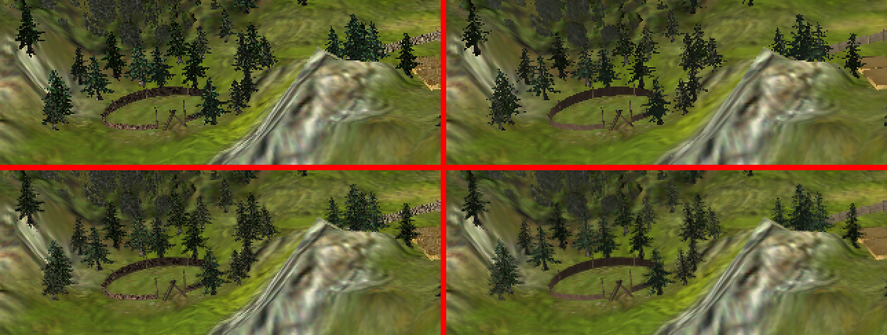

# Trees and forests

## Summary

Trees grow, sway, bend round what the hand carries and can be pulled up, thrown, replanted, felled, burned and
sacrificed; forests group them for the town's foresters. This page holds the trees' table and wood, the searches for
trees and forests, their growth, alignment and drawing, the flowers, and the sacrifice; the tug and the pick-up rules
are on [Grab, hold and throw](../hand/grab-hold-and-throw.md#tug), the tree's fire on [Fire](fire.md#fire-trees).

openblack ports the growth, the drawing, the bending and the searches, and the replanting in the original's order;
the sacrifice and a few searches without callers wait (see [Pending](#pending)). Everything is ✅ faithful (read in
runblack.exe or in info.dat) except what is marked **🔍 inferred**, **⚠️ approximate**, [assumed], *deviation* or
**pending**.

## The original

Trees seen up close in the original:

### Trees

Moved to [Trees and forests]() (uprooting, dropping, forests, growth, drawing).

### Flowers

`Flowers::CallVirtualFunctionsForCreation` (0x527A30), after the multi-cell fixed creation (0x52E890), calls four
virtuals on the 3D object:
- +0x1E8 `UpdateMelting` 0x8168F0: it morphs to the land once (`Flowers::Get3DType` 0x527980 = 1, morphable);
- +0x58(0) `SetDynamicLighting` 0x8168C0: unlit;
- +0x78(0) 0x8168A0: it receives no projected shadows (0x527A5D);
- +0x80(0) 0x7F9880: clears bit 0x1000 of obj+4, so it casts no shadow on the texture.

- BigForest::Create -> MultiMapFixed::CallVirtualFunctionsForCreation 0x52E890 (0x439057) -> InsertMapObject vt +0x544 (0x52EA14) = MultiMapFixed 0x52E650: the head of the fixed list of every cell of its descriptor

### Alignment

Uprooting a tree with the hand is an **evil** act (`Tree::InterfaceSetInMagicHand`) and replanting it (`Tree::EndPhysics`)
or the tree that the water plants (`Tree::ApplyWaterSpell`) are **good**: ±`treePullPutAlignmentChange` via
`GAlignment::Update` 0x4145A0. The value (`GAlignment`, GPlayer +0x60), the weight by the current alignment, the rate per
turn, the scripts and what is missing are in
[Influence and alignment](../magic/influence-and-alignment.md)
(`src/ECS/Effects/Alignment.*`, `components::Alignment`).

- DeadTree::DeadTree 0x510880 takes over the tree's 3D object (mesh, matrix, scale: 0x5108B2..0x5108B7) and info; SetScale 0x51092D may rebuild the matrix (below). The roots do not break off (only Tree::EndPhysics sets that flag)
- The DeadTree ctor fn_00510880's last call (0x51094A..0x510957): Reaction::CreateReaction(this, 12 REACT_TO_WOOD, GetPlayer (Rock 0x6E77A0: the ctor's player, +0x90), 0): every new DeadTree tells the villagers near it ("wood here", V8_V9_spec §9.2). Only that ctor makes it: a dropped log (fn_00510BB0 -> ctor 0x510A30, 0x510BF4) and the scripts' DeadTrees (CallNearInState 0x6F14E6 / 0x716EE4, the same 0x510A30 path) get none. Called by FellTree; (pending, Mano: HandTrees Tree::EndPhysics 0x74BBE2 via fn_00510B70, the other 0x510880 caller, calls it with PhysicsObject::GetPlayer). Returns the reaction id

### Growth

- Only the trees **of a forest** grow: in the original only `Forest::Process` 0x539DA0 walks its trees, so
  the loose trees of the script (all those of Land 1 and Land 2, which have forest −1) never grow. Those of Land 3
  (65), Land 4 (82) and Land 5 (164) do.
- A tree is born "growing" (bit 0 of +0x5E) only if its `maxSize` differs from the size it is created with, and its
  counter (+0x60) starts at a random turn in [0, growTurns) (ctor 0x749E00).
- Every `growTurns` turns (10 in the 22 types, i.e. 1 s): `amt = growAmt · (1 + 0.01·rainMultiplier·rain) ·
  (1 + 0.5·terrain alignment)`, and `scale = min(scale + amt, maxSize)`. `growAmt` 0.01 (0.02 conifer/pine, 0.005
  oak/olive/palm). On reaching the maximum it stops growing. `SetScale` is virtual and rebuilds the collision: the obstacle
  circle follows the size.
- **Forests** (`Forest`, ctor 0x539BD0; `ECS/Trees.cpp`): a forest is an object with a centre and an id (CREATE_FOREST, or
  `new Forest(pos, 0)` when replanting outside any forest; id 0 = the next free one). CREATE_TREE and CREATE_NEW_TREE
  look up the script's id in the forest list and, if it does not exist, the tree **has no forest** (0x7162BE): ids 0-6
  of Land5 and the −1 of Land1/Land2 are left without a forest. Every turn (`Forest::Process` 0x539DA0): an empty forest waits
  2000 turns and is deleted; otherwise, its trees grow and it can plant a new one: `r = 2000 + random(1000)`,
  `f = min(1, 0.05·grown)`, `T` = turns since the last tree that any forest planted (global 0xCD04C8),
  `c` = attempts of the forest (+1 per turn); if `c·f·T/300 > r`, it plants next to one of the `random(n/2+1)` grown trees nearest
  to its centre (`Forest::CreateNewTree` 0x539FD0) and `c` goes back to 0. **Planting next to a tree**
  (fn_0053A010): 32 angles from a random one (2π/32 between them) × 5 radii (random integer 5-9, then `(r+2) % 10`),
  the first free spot; the new tree is of the parent's type, size 0.1, maximum `0.8 + random(0.4)` and random angle.
  "Free" (fn_0074C180) = `(collide & 8) == 0 || IsWater`: no fixed object within a 0.5 m circle, or else a water
  cell. It is read literally, in the original and in openblack (`IsFreeForTree` in `ECS/Trees.cpp`): there is no land
  test, so a new tree can be planted on a water cell (details below). With a forest of 20 grown trees
  roughly one new tree appears in the world every minute and a half (checked in Land3: forest 19 planted one).
- The rain (`GClimate::GetMaxRainingOrSnowing`) and `MapCoords::GetAlignment` are both read at the tree's `MapCoords::GetLHPoint` 0x605C40, which is the land altitude plus the MapCoords' own y (0x74A2E5..0x74A31A).
- Planting next to a tree (fn_0053A010): GameFloatRand(2π) is drawn once (0x53A043); GameRand(5) + 5 at the start of each ring (0x53A065..0x53A073). The point is origin + GetPosFromAngle(a, float(r)) via `MapCoords::operator+` 0x605520 (0x53A086..0x53A0A6), tested by fn_0074C180 at 0x53A0B0.
- `Tree::Create`'s arguments are drawn right to left: size 0.1, then yAngle GameFloatRand(2π) (0x53A14E), then maxSize GameFloatRand(0.4) + 0.8 (0x53A168..0x53A16D).
- fn_0074C180 (its only caller is fn_0053A010, at 0x53A0B0): free when a 0.5 m circle at the point touches no collide data of the cell's fixed list (`MapCoords::CollideCollideWithFixe` 0x604FE0 at 0x74C187, `test al, 8` 0x74C18C). Otherwise it returns `MapCoords::IsWater` (0x74C192, returned at 0x74C199).
- Read literally, fn_0074C180 makes a water cell always free, and neither it nor fn_0053A010 (0x53A010..0x53A18F) tests land before `Tree::Create` 0x749EE0. Off the map CollideWithFixed is 0xFFFFFFFF (bit 8 set) and IsWater is 1.
- `Forest::Process`: r = GameFloatRand(1000) + 2000 is at 0x539F04..0x539F0C. `CreateNewTree` draws GameRand(n / 2 + 1) at 0x539FE4, with n = the grown list's count (+0x4C), so the pick is always < n.
- **Water on a tree** (`Tree::ApplyWaterSpell` 0x74C390, `ecs::ApplyWaterSpell`): one
  that is growing grows `waterMultiplier·growAmt`; with spell subtype 0x17 an adult one too, half via
  `GetDistanceModifier(size, 3)` (= `SigmoidThreshold(0.5, 1 − min(size,3)/3)`, 41-step table at 0xC23284),
  above its maximum. An adult one of a watered forest without 0x17, 40 turns after the last tree in the world, plants
  another next to it (the caller gives the good alignment and statistic 0xE). It sounds 0x78 + tick%9 (`G_TreeGrow`).

- Tree::Create(pos, GTreeInfo 0xDA49D8 = Pine (the GTreeInfo array: base 0xDA3AD8, stride 0x140, filled at 0x749D30; index 12), the BigForest's forest, maxSize 0.75 (0x8AC3F8) + GameFloatRand(0.5), yAngle GameFloatRand(2pi), size 0.05; the ctor keeps arg 4 as +0x64 maxSize, 0x749E4A): maxSize drawn first (0x4392FC, + 0.75 at 0x439309), then yAngle (0x439322)
- 0x539F04..0x539F0C
- CreateNewTree 0x539FD0: GameRand(n / 2 + 1) (0x539FE4), n = the list's count +0x4C, always < n
- 0x74A2E5..0x74A31A: GClimate::GetMaxRainingOrSnowing and MapCoords::GetAlignment are both asked at the tree's MapCoords::GetLHPoint 0x605C40, which is the land altitude plus the MapCoords' own y: that is what Transform::position already holds for a tree (TreeArchetype is created at GetHeightAt)
- Tree ctor 0x749E00: a tree grows only when maxSize differs from the size it is created at, and its first growth step falls on a random turn of [0, growTurns): GameRand(info +0x118) at 0x749E69 into the word +0x60 (0x749E71), 0 for 0 without a draw. CallVirtualFunctionsForCreation 0x74A0E7: the wind slot from the angle, so that trees facing the same way sway together.
- Tree::Create 0x749EE0 -> CallVirtualFunctionsForCreation vt +0x658 (0x749F49) -> InsertMapObject vt +0x544: SingleMapFixed 0x52E620 -> 0x52F440 -> Fixed::InsertMapObjectToCell 0x52DEA0, the head of its cell's fixed list

### Drawing

- **Unlit**: `Tree::CallVirtualFunctionsForCreation` (0x749F70) calls `SetDynamicLighting(0)` (vt+0x58, 0x749F87..
  0x749F89) on its 3D object, so the object draw takes the unlit path: every vertex gets the tree's colour as
  `Tree::Draw` leaves it, with no per-vertex N·L and no ambient 90 ([Model lighting](../rendering/model-lighting.md#model-lighting),
  "Unlit objects"). BigForest and DeadTree do the same (a dead tree also keeps the tree's 3D object). The colour, per
  byte: `rgb = (((Lcell · f) >> 8) · b) >> 8`, with Lcell the cell's light, f the haze and b the brightness below; the
  specular is the land colour plus the haze, saturated. Before, openblack lit the trees with the model light, darkening the faces turned away from it down to
  90/256 and the others to at most 254/256.
- **Swaying** (the same wind as the ripe fields, table `T0` and `Tree::PreDraw` 0x74A7C0 in
  [Objects](objects.md)): the trees
  (`Tree::Draw` 0x74B016) use the same table with factor 1: x of column 1 = 0, z = scale × T0[i], `i` = bits 2-5 of
  +0x5C; ported in RenderingSystem except with the tree tilted by the hand. The bending next to what passes nearby (bits
  6-9 of +0x5C, table 0xD19A48) is already ported for the hand and the physics objects (see "Bending", below); only the
  creature (slot 2) is missing, which does not exist yet.
- **Wind slot**: `round(yAngle·16/2π) & 15` (0x74A0E7), stored when the tree is created, so trees with the same
  orientation sway together (`components::Tree::windSlot`; before, openblack used a hash of the entity).
- **Brightness by camera** (`Tree::PreDraw` 0x74A883 → global 0xC22FA0, read only by tree code):
  `d = normalize(camera focus − light position)`, `v = normalize_xz(view direction)`,
  `b = dot < 0 ? 200 : 200 + 55·dot`, and `Tree::Draw` 0x74B077 multiplies each RGB channel of the tree's colour by `b/256`
  (0.781 … 0.996). The light is the only one LH3D keeps, [0xEA9E90], the same one for all models
  ([Model light](../rendering/model-lighting.md#model-lighting), `src/Graphics/ModelLight.h`): by day the default sun
  [0xEA1C88] = (−500000, 500000, −500000), which is indeed initialised (`fn_00818920` 0x818930; the "(0,0,0) because its
  `setter` is dead code" was a mistake of an earlier note). Only in **deep night** (sky type > 1.5, the double at
  [0x8C5838]; `fn_005E5830`, which places the light after `Tree::PreDraw`, so the trees use that of the previous
  frame) does the light go 3 units from the **hand** towards the camera, with the hand raised at least 10 above the terrain:
  then `dot ≈ cos(camera pitch)` and the trees look lighter.
- **The tree's own colour**: `fn_00802120` in `Tree::Draw` 0x74AB1B takes the 4 cells with weights `CellX >> 8` and
  `CellZ >> 8` (0x802206, 0x802237; SSE 0x7A42AC / 0x7A42BC), not the fraction: in practice, the cell alone (same
  tables 0xEDD90C and cells +3/+0xB/+0x8B/+0x93). Then the haze (0x74AB60).
- **Ambient leaf sound** (0x74B111): trees taller than 10 with the camera at ≤ 10 in x and z (and < 18 in y)
  sound ~once per second (`LocalRand(1000/frameMs) == 1`): row `{*,*,20,*,70}` of `editor.sad` =
  `G_TreeRustle_01..11` + `G_TreeCreak_01/02`.
- **Bending next to what passes nearby** (`Tree::Draw` 0x74AB8B, `fn_005DF1B0`, table 0xD19A48): every frame the table
  records the object the hand carries (slot 1: every object in the hand is "drawn in the hand"), the physics objects
  in flight (slots 3-13 per turn, `fn_00646FE0`) and the player's creature (slot 2; there is none yet), each with its
  position and a radius = scale × the half-diagonal of its mesh (LH3DMesh +0x30). Each source marks the trees of the 3 × 3
  10 m cells around it (the last one wins). A marked tree bends if its crown is not below the source
  (base + height ≥ y of the source) and the horizontal distance `d` is less than the radius `r`:
  `angle = 0.471239 · (1 − ((r − 0.75)·d/r + 0.75)/r)` (27° at most), around the horizontal axis perpendicular to the
  source→tree direction, the crown **moving away** from the source; only the drawn matrix, and in that frame without swaying.
  Sound on starting to bend: key `{c, *, *, 10, 75}` of `editor.sad` with `c = 3` if the bend is < 0.3 (no
  samples), 2 if < 0.67, 1 otherwise: `G_Crash_Tree_M_01..08` ("rubbing trees"). Checked with a rock in the hand (`OPENBLACK_HAND_TEST_HOLD=1.5`): the nearby trees move aside and play `G_Crash_Tree_M_05/07`.
- The bend table is fed each frame from `GLandscape::Draw` 0x5E4960 / 0x5E49DC and fn_00646FE0 (fn_005DF1B0). The held object is passed with the G3D's drawn position in the hand (0x5E49C1..0x5E49CA). The physics objects are passed with their interpolated position (0x647182..0x6471A4).
- **The hand put away bends nothing.** `GLandscape::Draw` takes the hand's LH3DObject (the local player's CHand, player +0x3A0, its +0x482C) and passes slot 1 only when that object has a mesh (vt 0xF8, 0x5E492D) and is drawn: +0xAC == 0 (0x5E495A..0x5E4962, else to 0x5E49DC, the physics objects). Slot 1 is then the object hung on the hand's LH3DObject (+0x8C, 0x5E4994), with radius its scale (+0x44) × its mesh's +0x30 (0x5E49A8..0x5E49BD). The hand itself is never a source. +0xAC is the "not drawn" flag `CHand::Hide` 0x46C2E0 sets (0x46C2E9) and `CHand::Show` 0x46C1B0 clears (0x46C1B9), from `HandStateInvisible::Enter` / `Exit`: the hand's INVISIBLE state, required for the interface hand states 1, 2, 12 and 25 (25 = the interface inactive, as under a script's cinema bars) ([Hidden hand and CHand's states](../hand/animation-and-placement.md#hidden-hand-and-chands-states)). In `GGame` the frame's order is `CHand::PrepareForDrawing` (the state change, so the Hide) and then `GLandscape::Draw` (bw1-decomp `Game.cpp`), so the hand put away bends nothing from the frame it is put away. Testbed scenario `hand.put_away_over_trees`.
- Ambient leaf sound: the random draw comes first, for every tree drawn, before the distance tests (0x74B111..0x74B140): n = ftol(1000 (float [0x8AB228]) / g_game +0x205D48). With 0 ms (pause) 1000 / 0 is +inf, which __ftol 0x7A1400 turns into 0x80000000, so LocalRand divides by 2^31. The comparison with 1 is at 0x74B135..0x74B13D.

### Sacrifice

- **Sacrifice** (postponed by the user): dropping a tree aimed at the **WorshipTotem** (CitadelPart of the worship
  site; `ValidToApplyThisToObject` 0x74BD50): v = sacrificeValue·life·(0.5 + 0.5·life) to the site's mana
  (+0xF0) and to the total (+0xF4), ghost of the tree (`GoolooGooloo`), `G_SACRIFICE_01`, red floating number "%3.0f".
  Villagers ×1.25; food, rocks and pots no. **Pending**: the sacrifice is not ported (`GET_SACRIFICE_TOTAL` gives 0
  in `CHLApi.cpp`). The worship sites it needs already exist (`src/Worship`; `CREATE_WORSHIP_SITE` calls
  `magic::script::CreateWorshipSite`, see
  [Worship](../magic/worship.md)).

### Tree details

- Vt +0x42C (0x53A75D, 0x53A78E)
- CleanupWhenDeleted 0x6377F0: RemoveMapObject vt +0x548, out of its cell's fixed list
- fn_0053AE10: every town (g_game +0x205C84) drops the forest from its list Town +0x608 (fn_00741A70)
- BigForest::GetCarriedTreeType 0x438DE0: info (+0x28) +0x124. 🔍 inferred BigForestArchetype keeps no info index (BigForest::type stays 0); the four GBigForestInfo rows of info.dat all have carriedType 3 (file 0x8614C, 0x86264, 0x8637C, 0x86494), so the row is exact whatever it is
- fn_00510880 0x51094A..0x510957: CreateReaction(this, 0xC, GetPlayer (Rock 0x6E77A0), 0)
- 0x511404..0x511413: PhysicsObject::GetPlayer 0x647460 = +0x24 (the GInterfaceStatus) ? its GetPlayer : 0. 🔍 inferred openblack's PhysicsObject::byPlayer is the local hand's throw (HandPhysics: PLAYER_ONE)
- 0x7509A6..0x7509C1: fn_00510BB0(pos, Pine, 0, 1.0, pi/2, 0, 0, mesh); the ctor 0x510A30 and SetXYZAngles (vt +0x518) are DeadTreeArchetype::Create's
- No reaction here: the ctor 0x510A30 (0x510BF4) makes none (0x510A30..0x510A8B calls only the Rock ctor 0x6E6F70, fn_00510A80 and SetLife); the log tells the villagers only when it lands (DeadTreeEndPhysicsReaction, 0x511413)
- 0x510BFF..0x510C03: [0xCC5F10] = mesh while CallVirtualFunctionsForCreation runs: GetDeadTreeMesh 0x510C60 gives it instead of the tree type's mesh
- 0x510C30 `and word [esi+0x98], 0xFFEF` (a flag bit of +0x98, not identified): (not ported), as in DeadTreeArchetype::Create
- 0x51179E: |d|^2 <= 0.001 (0x8AA3B0) gives a = 0 (fld [0x8AA398] 0x5117BE); else call 0x7FAA50 (0x5117A8), whose value stays on the FPU stack for the fsin / fcos (0x5117C4..0x5117F8): the double, not rounded to a float
- The spin is a BODY-space angular velocity in the original's sign: PhysicsObject::AddObject 0x6443A0 builds the angular momentum from it as (w M8) summed over the body's rows (0x6445DB..0x644691), the new DeadTree's matrix (SetUpPos 0x63A603): the tree's yaw at scale 1.0, else the identity (below): PhysicsObjects::BodySpin. w = (cos a k, 0, sin a k) x (1 / h2), each product a float (0x5117F8..0x511838: the stored velocity components times the stored 1 / h2; about 0.4 (cos a, 0, sin a))
- Villager::ForesterChopsTree 0x75FAE7 then calls tree->ToBeDeleted(0): the tree leaves its forest and whoever listens (hand, reactions) lets go of it. Its fire (+0x44) moves to the DeadTree (fn_00730960): kept here because it is the same entity.
- The ToBeDeleted of 0x75FAE7 -> CleanupWhenDeleted 0x6377F0: RemoveMapObject vt +0x548. The DeadTree enters the map when the physics puts it to rest (EndPhysics, vt +0x544)
- The DeadTree ctor (fn_00510BB0 -> 0x510880, its player the LOCAL one: ebp = g_game + 0x18 + 0xA60 x (byte g_game +0x205A5B), 0x511747..0x511759) ends in CreateReaction(this, 12, GetPlayer, 0) (0x510957): spread at once
- SetScale(the tree's scale) 0x51092D -> Object::SetScale 0x639200: only when it differs from the DeadTree's own 1.0 (fcomp 0x63920B) is the matrix rebuilt from the DeadTree's angles, all 0 (SetYAngle(0) 0x52DDFB): axis-aligned. At scale 1.0 the tree's matrix, with its yaw, stays
- GUtils::Spiral 0x74D7E0 with the step table 0xDA59FC {(1,0), (0,1), (-1,0), (0,-1)}, started with dir 1 and steps 1 (Villager::FindTreeNearVillager 0x75FD1A, Town::MakeScenicForest 0x741BB9): each call does `if (--steps == 0) { ++dir; steps = dir / 2; }` and moves by table[dir & 3]. The offsets it visits, the centre first: (0,0) (-1,0) (-1,-1) (0,-1) (1,-1) (1,0) (1,1) (0,1) (-1,1) ...
- 0x47C34F80
- MapCoords::FindType(6, 0) 0x75FD57: only the first FOREST_TREE of the cell's fixed list; when it is not a Tree (__RTDynamicCast 0x75FD5D) the cell is skipped. INDESTRUCTIBLE (+0x25 & 0x40, 0x75FD6B) is never set on a tree outside puzzles
- R = 250 (GTownInfo +0x164) + 10 (0x8AB414). The spiral (GUtils::Spiral 0x74D7E0 at 0x741CC5, MapCoords += JustMapXZ 0x605470) walks a copy of the town centre's MapCoords (fn_0073AE10), at most 99999 (0x1869F) cells, and stops at the first one farther than R from the centre (fn_00605CD0; "fcomp; test ah, 0x41" 0x741BC2..0x741BD0). In each cell FindType(-1, 0) 0x741BDE .. FindType(-1, obj) 0x741CA1: the fixed list, then the mobile one, each from its head; CastTree vt +0xBC. The trees join the scenic forest in that order
- GetForest vt +0x86C: none (0x741C17), or a scenic one (+0x3C, 0x741C1B) whose centre is farther from the tree than the town centre (0x741C21..0x741C44, then fn_0053A220 takes it out of it)
- The global list, newest first; fn_00741AF0 inserts at the head (no duplicates)
- BigForest::ToBeDeleted 0x438EA7: forest +0x38 = 0, the Forest stays
- CleanupWhenDeleted 0x6377F0: RemoveMapObject vt +0x548 (MultiMapFixed 0x52E7B0), out of all its cells
- 0x439250..0x439274: position + GetPosFromAngle(GameFloatRand(2 pi), R)
- 0x43928E..0x4392C9: MapCoords::FindType(-1, 0) / FindType(-1, obj) over p's cell (the fixed list, then the mobile one; the BigForest itself counts too): none with fn_00605CD0 (GetDistanceInMetres, 0x4392A1) plus its GetRadius (vt +0x60 at 0x4392AE, not Get2DRadius) under 4 ("fcomp 4.0; test ah, 1")
- 0x74A2FA (x 0.01), 0x74A306 (x info +0x130), 0x74A30E / 0x74A312 (x growthAmount, + growthAmount), then 0x74A31F (x 0.5), 0x74A329 (+ 1) and 0x74A32F (x the running value)
- GetCarriedTreeType (Tree 0x55D900: info carriedType; DeadTree 0x511A20: 0-3 when its mesh is one of the four CarriedObject::Init 0x462600 logs, MeshPack 406 / 347 / 348 / 349, else the tree info's carriedType; BigForest 0x438DE0: its GBigForestInfo carriedType, info +0x124): the log a villager carries it as.
- DeadTree::EndPhysics 0x5113F0: Rock::EndPhysics 0x6E7000, then CreateReaction(this, 12, PhysicsObject::GetPlayer 0x647460 (the GInterfaceStatus that threw it: the hand's player, else none), 0) (0x511404..0x511413): a log that lands tells the villagers again. Not for a felled tree (FelledTree::EndPhysics 0x511970 = Fixed::EndPhysics only). (pending, the physics area: the DeadTree endPhysics physics handler; Mano: the hand's landing path calls it) no caller yet; `byPlayer` is PhysicsObject::byPlayer
- The log a loaded villager drops (Villager::CreateDroppedResource 0x7509A6..0x7509E7): DeadTree::Create fn_00510BB0( pos, GTreeInfo 0xDA49D8 (Pine), player 0, life 1.0, x angle pi/2 (0x3FC90FDB), 0, 0, mesh) with the mesh override (0xCC5F10, read by DeadTree::GetDeadTreeMesh 0x510C60) and DeadTree +0x9C = woodMultiplier. Not put into physics here (the caller does). Session the villagers' area (V5), agreed with coordinador: trees have no owner.
- Villager::FindTreeNearVillager 0x75FD00: the 9 cells around `who` in the order of GUtils::Spiral (0x74D7E0, table 0xDA59FC, dir 1 steps 1: (0,0) (-1,0) (-1,-1) (0,-1) (1,-1) (1,0) (1,1) (0,1) (-1,1)), in each only the FIRST tree of the cell (FindType(6) 0x6045C0) that is not INDESTRUCTIBLE (Object +0x24 bit 0x4000; set only by puzzle objects: no tree has it in a normal game); the nearest by Dist2D(who, its working position), from 99999 (0x47C34F80). No other rule (no distance limit, no scenic bit, no size, no forest). entt::null when none; the caller tells "touching" (10) from "found" (1) with IsTouching.
- Town::AssignForestsToTown 0x73EB00: the town's forest list (Town +0x608) cleared and filled again with every forest whose nearest point (a BigForest's nearest edge, otherwise its centre; fn_0053ADB0) is within GTownInfo::maxDistanceForTownForest (250, +0x164) of `reference` (the town's storage pit, or its temporary store point) and that has wood (fn_0053B280 > 0). Called by Town::AsssignTownFeature 0x73EAC0 (after MakeScenicForest, for every town) and Scaffold::BuildBuilding 0x6E932C; not when trees are made or planted.
- Town +0x608: the town's forests (head first: fn_00741AF0 inserts at the head)
- BigForest::RemoveResource 0x4390D0 (WOOD only): n / life wood taken; when it has no more than that, it gives what it had (ftol of GetWoodValue) and is deleted; otherwise its wood (+0x84) goes down, and once its GetWoodValue is more than 250.0 (0x8C6210) away from life x scale x woodValue it is rescaled to GetWoodValue / (life x woodValue) and a sapling is planted at its edge (AddTreeAround 0x439220: up to 10 random angles at its radius, on land with no object nearer than 4; a Pine (GTreeInfo 0xDA49D8) of its forest, size 0.05, maximum 0.75 + rand(0.5), random angle). Returns what was taken (n, or what it had).

### Tree roots

- fn_00511270's factor, 0.15 [0x8CF110] x the tree mesh's extent (LH3DMesh +0x24, 0x5112B2..0x5112BD): the nine rotation elements of the tree's drawn matrix are multiplied by it, the translation is not (0x5112C3..0x511304)

### Making a tree

- 0x74A06B..0x74A0C7

### Sources

- bw1-decomp `src/Black/Object.cpp:539`: the normal test on dropping (only living beings and fences).
- info.dat: the values of the trees (wood, weight, `defenceMultiplierBurn` 0.01…).

## openblack

Status: **partial**. Progress rows: [trees](../project/progress/nature/trees.md) (77%),
[forests](../project/progress/nature/forests.md) (66%), [plants and flowers](../project/progress/nature/plants_and_flowers.md)
(81%).

- `src/ECS/Trees.{h,cpp}`, `src/ECS/Components/Tree.h`, `src/ECS/Components/TreeRoots.h`,
  `src/ECS/Archetypes/TreeArchetype.cpp` and `BigForestArchetype.cpp`; `ECS/TreeReplant.h` (the replanting steps,
  run by `HandSystem::Replant`);
- tree and forest state lives in components and the systems are reached through Locator services; the growth, wood
  and search formulas are pure functions tested with fakes.

Porting decisions taken from raffclar's tree (unlit trees, the forests' slot, the forest's camera creator, flowers):
[Port decisions: engine and world](../project/port-decisions-engine-world.md#world).

#### General

- openblack code: `src/ECS/Trees.{h,cpp}`, `HandTrees.cpp`.
- `BigForestArchetype::Create`: inserts the forest into the fixed list of every map cell of its shape, at the head.
- `SpiralOffsets` (Trees.cpp): the cell offsets of the original's spiral walk, the centre first; `FindTreeNearVillager` walks 9 of them and takes only the first `ObjectType::ForestTree` of each cell.
- `TownForests` (Trees.h): the town's forests, newest first.
- `FellTree` (Trees.cpp): a felled tree gives `Reaction::ReactToWood` for the local player, then `NotifyTreeDeleted(tree, TreeDeletion::BecameDeadTree)` makes the hand and the reactions let go; its fire stays with the dead tree, which is the same entity. `CreateDeadTreeReaction` gives a dead tree the same reaction.

#### Flowers

- openblack: `FlowersArchetype` gives `MorphWithTerrain` (made once) and `Unlit`, and `RenderingSystem` keeps flowers out of the static shadow casters (with `ShadowList`) and the receivers (`shadow_receiver::Object::flowers`).

#### Growth

- openblack: `src/ECS/Trees.cpp` (`ProcessTreesTurn`, `GrowTree`), called from the world turn (`src/Magic/MagicLoop.cpp`). The rain and the terrain alignment are read: `TreeGrowthAmount` computes `amt` in the original's order (and `ProcessField` in `src/ECS/Fields.cpp` does the same for the fields). Hooks `OPENBLACK_TEST_TREE_GROWTH="x,z"` (two saplings, one with a forest and another without), `OPENBLACK_TREE_TRACE=1` (each growth step and the brightness) and `OPENBLACK_TEST_REPLANT="x,z,tiltDegrees"` (drops a tree there and says whether it is replanted, falls or stays dead).

#### Drawing

- openblack: `components::Unlit` on the Tree, DeadTree and BigForest archetypes, `argb_colour::PackInstanceUnlit`, and `vs_object` leaves out the model light for those instances.
- openblack: `land_light::ObjectMode::CellShift` (`vs_object`, `LandLightCellShift` of `land_light.sh`); see [Haze and land light: the common API](haze-and-mist.md#haze-and-land-light-the-common-api). openblack: `ecs::TreeBrightness()` in `ECS/Trees.cpp`, carried as a tint in the x of the instance's fifth column with w = 1 (`argb_colour::PackInstanceTreeTint`, [The object colour fields in the instance](../rendering/model-lighting.md#the-object-colour-fields-in-the-instance)): `vs_object` applies it after the haze, like `Tree::Draw`, which does not call `fn_0080BF10` but multiplies the +0x4C already hazed (0x74AB60 → 0x74B077..0x74B0C4; burning, `fn_0074B3A0` 0x74B48F..0x74B4D3).
- openblack: `ecs::UpdateTrees` + `AnimationSounds::PlayFromTable`.
- openblack: `ecs::UpdateTreeBends` (after the hand, [The original loop](../engine/loop.md#the-original-loop); `Tree::bendAngle/bendDirection`) and `RenderingSystem.cpp`.
- openblack: `UpdateTreeBends` takes the held object only when the player's hand has no `NotDrawn` (`ecs::HeldBendSource`), and runs after the hand's frame update, so the cut comes in the same frame as the original's, 2026-10-11; raffclar's version (the hand itself as a bend point, cut by a dialog or an inactive interface) is not taken, as the original bends round what the hand holds, not round the hand.

### Test hooks

- `OPENBLACK_TEST_TUG="x,z,wait,hold"` (+ `OPENBLACK_TEST_TUG_MOUSE2="x,y"`) and `OPENBLACK_HAND_TRACE=1`: the tug of a
  beech made at x,z. With the mouse still, pressed within about a metre of its grip it stays in the ground, pressed
  higher up it comes out after the hand's 0.13 s fade (since 2026-10-16; before, it never came out without the mouse
  moving). The testbed's `hand.tug_*` scenes show the grip, the crown, a release and a tree too heavy to come out.
- `OPENBLACK_TEST_REPLANT="x,z,tiltDegrees"`: drops a tree and says whether it is replanted, falls or stays dead.
- `OPENBLACK_TEST_FELL="x,z"`: felling.
- `OPENBLACK_TEST_TREE_QUERIES="x,z"`: searches for trees and forests, `MakeScenicForest`, `AssignForestsToTown`.
- `OPENBLACK_HAND_TEST_FOREST=1`: taking from a BigForest.
- `OPENBLACK_TEST_TREE_GROWTH="x,z"` and `OPENBLACK_TREE_TRACE=1`: growth and brightness.
- `OPENBLACK_HAND_TEST_HOLD=1.5`: bending of the trees next to what the hand carries.
- Fire: the hooks of [Fire](fire.md#test-hooks) (`OPENBLACK_TEST_FIRE`).

## Pending

- **Verify with xref/oracle:** the 2 **🔍 inferred** and 0 **⚠️ approximate** marks in The original above. Each is settled by reading the function named next to it (`python dev/tools/xref/xref.py show <function>`) and, where a number is in doubt, by an oracle run of that function (`dev/tools/oracle/GUIDE.md`).

- Tug: the press frame. openblack takes the pull's plane at the press, one frame before the original's state Enter,
  because its hand already takes its tug placement on the press frame (see the Tug section); the hand's placement
  following the hand's state is a change of its own, not made yet.
- Replanting: the original's order is read (`Tree::EndPhysics`: `SmokyStuff::Create` 0x74B95A at the ground altitude,
  then `StartImmersion(0x2E, 0x80000000)` 0x74B97D on `GetInterfaceStatusWhoLastDroppedMe` 0x74B964 when there is one,
  then the forest search from 0x74B982, the forest at 0x74BB04..0x74BB62, the spot visual 0x74BB7C (given the body's
  player through its vt +0x20), and with a player the mimicry 0x74BBB1 and the alignment 0x74BBBD) and ported unwired as
  `ECS/TreeReplant.h`; `HandSystem::Replant` runs its steps in that order (2026-10-16).
  The immersion is force feedback, which openblack does not drive. The mimicry and the alignment are the body's player's
  (the hand's status +0x24, inherited from what hit it: `PhysicsEntry::byPlayer`; openblack's only hand is player
  one's, as on every hand path), and neither runs without one (2026-10-16). The spot visual is given that player (vt +0x20, `GParticleContainer::SetPlayer` 0x63E3C0, which passes
  it on to its effect's own SetPlayer; SF_ForestCreated has a point creator, green spangles with UsePlayerColor 0
  and a white vortex mesh, so nothing on screen depends on it); openblack gives it too
  (`SetSpotVisualPlayer`, 2026-10-16).
- `MakeScenicForest` and `AssignForestsToTown` without a caller (map load and finished buildings): the villages have no
  forest list.
- Growth and fields: the rain and the terrain alignment (`MapCoords::GetAlignment`). The weather already exists
  (`src/ECS/Weather`); only `GrowTree` reading it is missing. For the user it is the first thing that can be done now.
- Bending: the player's creature (slot 2).
- Bending: the original's held source is the object hung on the hand's 3D object (+0x8C, read at 0x5E4994 in
  `GLandscape::Draw`), while openblack takes the hand's held object (`HandSystem::_held`, `GetHeldObject`). Who sets
  +0x8C is not traced, so whether the two are always the same object is not known.
- Sacrifice (postponed by the user).
- Putting a tree into a building site under construction (`Scaffold`): the building sites are missing.
- Dead and felled tree: the reaction 0x0C "there is wood here" (DeadTree constructor 0x510957, `FelledTree::Create`
  0x511889) awaits the reaction system; the woodcutters' villager jobs will use the API above. The trunk that
  shrinks as wood is taken from it is already in `RemoveWood`; it only needs the villager jobs to call it.
- Creature: avoiding the trees when walking (no creature yet).
- Sounds: the rustle, the rubbing and `G_TreeGrow` of `Trees.cpp` move to the audio engine without changing
  the choice of sample; check them with `OPENBLACK_HAND_TEST_HOLD=1.5` and `OPENBLACK_TEST_TREE_GROWTH`.

